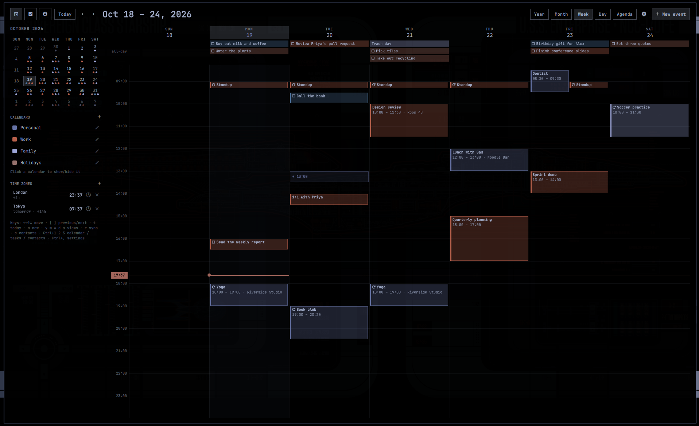
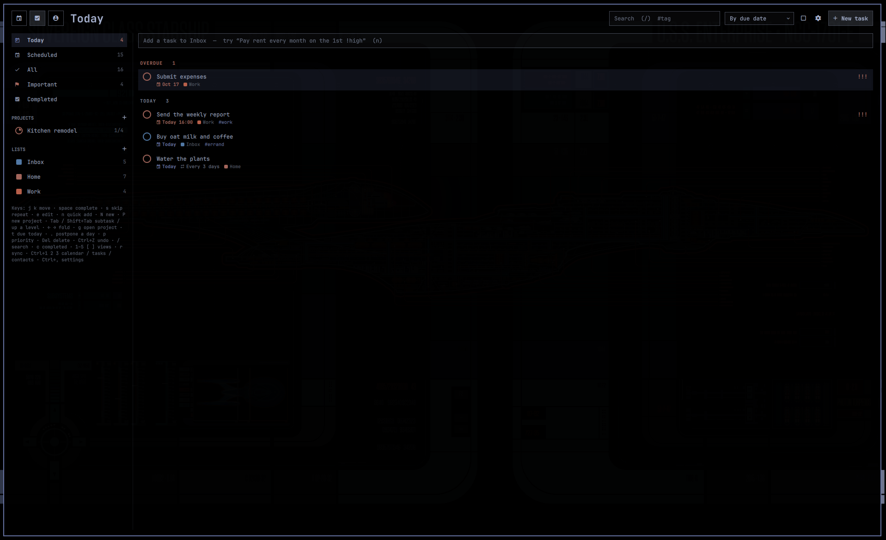

# Cart's Tasks and Calendar

A calendar, task manager and address book for [Omarchy](https://omarchy.org),
built on its own shell, so it looks and feels like the rest of your desktop
and follows your theme.

<!-- Screenshots: save them in docs/screenshots/ and uncomment.


-->

It comes in two parts that share everything:

- **A bar clock** that replaces Omarchy's, with a pop-out calendar that also
  lists the day's tasks.
- **An app** that tiles like any other window, with three modes:
  **Calendar**, **Tasks** and **Contacts**.

It syncs with the services you already use (iCloud, Fastmail, Nextcloud,
Google and Outlook calendar links, or any CalDAV/CardDAV server), or keeps
everything on your computer. Your passwords stay in the system keyring.

> An independent project, not part of Omarchy. No notifications or reminders,
> by design.

## Features

**Calendar**
- Month, week, day, agenda and year views.
- Drag to move, resize or create events.
- Repeating events, including "this event / this and following / all"
  edits.
- Each event can have its own time zone; world clocks in the sidebar.
- Hide events from shared calendars just for yourself.

**Tasks**
- Smart lists (Today, Scheduled, All, Important, Completed), your own lists,
  and projects with nested subtasks.
- Quick add in plain language: `Pay rent every month on the 1st #bills !high`.
- Repeating tasks, including "every 6 weeks after completion".
- Tasks with a due date can show on the calendar; drag one to reschedule it.
- Stored as standard CalDAV tasks, so they also show up in Apple Reminders,
  Thunderbird, tasks.org, Nextcloud Tasks and others.

**Contacts**
- Browse, search and edit CardDAV address books.

**Everywhere**
- Keyboard-driven, with mouse support throughout.
- Calendar colors follow your Omarchy theme (or pick a fixed color).
- Undo for task changes (complete, skip, move, delete) and for hiding events.

## Requirements

- [Omarchy](https://omarchy.org) (its shell, Quickshell, and Hyprland)
- `python3` (standard library only, used for syncing)
- `secret-tool` (libsecret), for passwords in the keyring
- `wl-copy`, to copy contact details

## Install

Add the plugin, put the clock on your bar in place of Omarchy's, and add the
app to your launcher:

```
omarchy plugin add https://github.com/carterra3/carts-tasks-and-calendar --enable
omarchy plugin disable omarchy.clock
~/.config/omarchy/plugins/carterra3.carts/bin/carts --install
```

`omarchy plugin add` warns you before installing third-party code and asks
which bar section the clock goes in (center is preselected). To keep it exactly centered like the stock
clock, set `"centerAnchor": "carterra3.carts"` under `bar` in
`~/.config/omarchy/shell.json`.

`--install` adds **Cart's Tasks and Calendar** to the app launcher and puts a
`carts` command in `~/.local/bin`.

**Just the app, without the bar clock:** clone the repo anywhere and run
`bin/carts --install` from it.

**Update:** `omarchy plugin update carterra3.carts`.

**Uninstall:**

```
omarchy plugin remove carterra3.carts
omarchy plugin enable omarchy.clock
rm -r ~/.local/share/applications/carts.desktop ~/.local/bin/carts ~/.cache/carts
```

Your data stays in `~/.local/share/carts` until you delete it. The passwords
are listed by `secret-tool search --all service carts`.

## Getting started

1. Open the app from the launcher (or run `carts`), or click the clock.
2. Click **+** next to CALENDARS to add a calendar: on this computer, a
   subscription link, or an account.
3. Press `Ctrl+2` for Tasks. Type into the box at the top and press Enter.
4. Press `Ctrl+,` for settings, including where tasks show up.

### Connecting accounts

| Service | What to enter |
|---|---|
| iCloud | Your Apple ID email and an [app-specific password](https://account.apple.com) (Sign-In and Security → App-Specific Passwords). |
| Fastmail | Your address and an app password with CalDAV/CardDAV access (Settings → Privacy & Security). |
| Nextcloud | Your server address and an app password (Personal settings → Security). |
| Other CalDAV / CardDAV | The server or principal URL, username and password. |
| Google, Outlook, Proton, any `.ics` link | Add it as a **Link** (read-only): Google's "Secret address in iCal format", Outlook's "Publish a calendar" ICS link, Proton's "Share with anyone" link. |

One account serves calendars, task lists and address books. Removing the last
thing that uses an account removes its password from the keyring.

## The bar clock and popup

| On the clock | Does |
|---|---|
| Left click | Open / close the popup |
| Right click | Cycle the clock format |
| Middle click | Time zone picker |
| Hover | Today's events |

The popup has month, week, day and agenda views in three sizes. Click empty
time to add an event; click a day while editing to move the event there.
Under the selected day's events it lists that day's tasks (and anything
overdue, on today); tick the box to complete one, click it to open it in the
app.

Keys in the popup: arrows or `hjkl` move the day, `[` `]` previous/next,
`t` today, `n` new event, `m` `w` `d` `a` views, `s` size, `o` open the app,
`r` sync, Esc close.

A 12-hour clock format (with `AP`) makes the popup and the app 12-hour too.

## The app

Opening it again focuses the running window; closing the window quits it.
It has a toolbar, a sidebar, the main view, and a drawer on the right for
editors and settings.

| Keys | Everywhere |
|---|---|
| `Ctrl+1` `Ctrl+2` `Ctrl+3` | Calendar / Tasks / Contacts (`Ctrl+Tab` cycles) |
| `Ctrl+,` | Settings |
| `r` | Sync now |
| Esc | Close the drawer |

### Calendar

| Keys | |
|---|---|
| arrows / `hjkl` | Move the day |
| `[` `]`, PageUp / PageDown | Previous / next period |
| `t` | Today |
| `n` or Enter | New event |
| `y` `m` `w` `d` `a` | Year, month, week, day, agenda |
| `c` | Contacts |

- **Week / Day:** drag an event to move it, drag its bottom edge to resize,
  drag on empty time to create one. Moves snap to 15 minutes.
- **Month:** drag an event to another day; times are kept.
- **Year:** click a day to select it, again to open it; click a month name to
  open the month.
- **Repeating events:** daily, weekly on chosen days, every weekday, monthly
  by date or by "2nd Tuesday", yearly, with an end date or count. Changing
  one occurrence asks whether to change just it, it and the following ones,
  or all.
- **Time zones:** give a timed event its own zone; it keeps its time there
  across daylight-saving changes. **TIME ZONES** in the sidebar adds world
  clocks; the clock icon on one adds it as a second hour column in week and
  day views.
- **Times and dates** can be typed loosely: `14:30`, `2:30pm`, `2pm`, `1430`;
  `2026-10-16`, `10/16`, `10/16/26`.
- **Hide** an event from a shared calendar to remove it from your own view
  only (choose **Hide this one** or **Hide all repeats** for a repeating
  event). **Hidden events** under Calendars lists them, with **Unhide**.
  **Delete for everyone** still removes an event from the server.

### Tasks

| Keys | |
|---|---|
| `j` `k` | Move |
| space or `x` | Complete |
| `s` | Skip to the next repeat |
| `e` or Enter | Edit |
| `n` / `N` / `P` | Quick add / new task form / new project |
| `Tab` / `Shift+Tab` | Make a subtask of the task above / move up a level |
| `←` `→` (`h` `l`) | Fold / unfold subtasks |
| `g` | Open the selected project |
| `t` / `.` | Due today / postpone a day |
| `p` | Cycle priority |
| Delete | Delete (with its subtasks) |
| `Ctrl+Z` | Undo |
| `/` | Search (`#tag` filters by tag) |
| `c` | Show completed |
| `1`–`5`, `[` `]` | Smart lists, previous / next list |

**Quick add** understands:

- dates: `today`, `tomorrow`, `fri`, `next monday`, `next week`, `in 3 days`,
  `oct 31`, `10/31`, `2026-10-31`
- times: `at 5pm`, `17:30`, `noon`, `tonight`
- repeats: `daily`, `every 3 days`, `every other week`, `every weekday`,
  `every tue and fri`, `every month on the 1st`, `every oct 31`, `yearly`,
  and `after completion` to count from when you finish it
- `!high` `!med` `!low` (or `!!!` `!!` `!`), `#tag`, `@List`, and `^Project`
  to add it as a step of a project

A preview under the box shows what it understood.

- **Projects:** any task with subtasks (or one marked **Project**) is listed
  under Projects with a progress ring. Subtasks can nest as deep as you like.
- **Repeating tasks:** completing one moves it to its next date and keeps a
  completed copy as history. Done late, the next date is the first one after
  today, so a missed daily task doesn't pile up.
- **On the calendar:** tasks with a due date show in the calendar views in
  their list's color. Click one to edit it; drag it to a new day or time.
- **Lists** can live on this computer or on a CalDAV account; **+** next to
  LISTS can also create a new list on the server. The eye on a list hides it
  from the smart lists and the calendar.

Editing a synced task only changes what the form shows; alarms, attachments
and other apps' data on it are kept.

### Contacts

`↑` `↓` or `j` `k` move, `/` search, `n` new, `e` edit, `c` back to the
calendar. Click a phone number, email, website or address to use it;
right-click copies it. Search matches names, companies, emails, phone digits,
addresses and notes.

### Settings

| Setting | |
|---|---|
| Show tasks on the calendar | On by default; optionally include completed tasks |
| Tasks in the bar popup | Off, day list (default), or day list + calendar |
| Completing a task with open subtasks | Ask, complete them too, or leave them open |
| Last subtask completes the parent | Off by default |
| Tasks with subtasks are projects | On by default |
| Keep history of repeats | On by default |
| Quick add goes to | The list new tasks land in |

## Command line

```
carts                  open, or focus the open window
carts 2026-10-31 week  open on a day and view (month|week|day|agenda|year)
carts --new            new event
carts --tasks [LIST]   open Tasks (today|scheduled|all|important|completed)
carts --new-task       new task
carts --add TEXT       add a task to the running app, in quick-add syntax
carts --contacts       open Contacts
carts --toggle         open, or quit if open
carts --quit
```

For example, bind a key to `carts --new-task`, or to
`omarchy-shell carterra3.carts newEvent` for a new event in the popup. More in
[docs/DEVELOPMENT.md](docs/DEVELOPMENT.md#ipc).

## Syncing and privacy

- Everything is stored in `~/.local/share/carts` (readable only by you).
  Passwords and private calendar links go in the system keyring, never in
  files or on a command line.
- Calendars sync at startup, every 15 minutes and when you open the app or
  the popup; task lists every 10 minutes. Unchanged calendars are cheap to
  check, so frequent syncs cost little.
- Edits go straight to the server and never overwrite a change someone made
  elsewhere in the meantime; you get a message instead.
- Removing a calendar, list or address book only unsubscribes it here.
  Nothing is deleted on the server.
- Only `https://` is used (plain `http://` only to your own machine), and
  passwords are never sent to another site on a redirect. Details in
  [docs/SECURITY.md](docs/SECURITY.md).
- Google can take several hours to update a secret iCal link.

## Known limits

- No notifications or reminders. Alarms set in other apps are kept, not shown.
- Repeating events from servers are shown from 120 days back to 400 days
  ahead.
- The calendar shows the current occurrence of a repeating task only.
- Timed tasks in another time zone are shown in local time.
- Tasks can't be dragged to reorder within a list.
- Contacts: no groups, no editing photos (existing ones are kept), and
  birthdays don't show on the calendar.

## Contributing

Bug reports and pull requests are welcome. See
[docs/DEVELOPMENT.md](docs/DEVELOPMENT.md) for how it's put together and how
to run the tests, and `python3 tools/demo.py` to try it on made-up data.

## License

[MIT](LICENSE)
